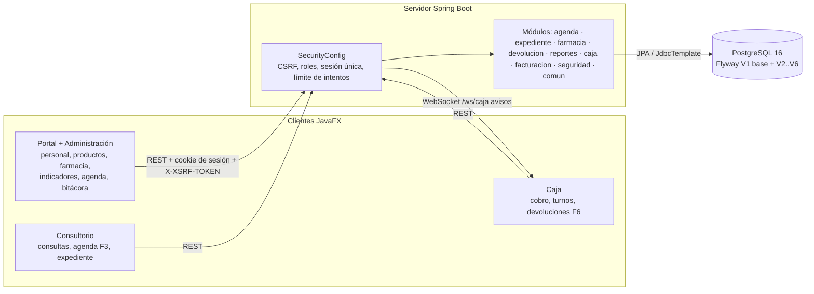
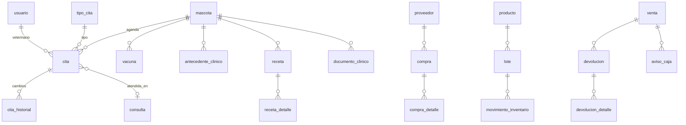

# Actualización integral (agenda, expediente, farmacia, indicadores y seguridad)

Rama local `feature/integral`, construida sobre `test/estabilizacion`. Resultados de pruebas: `docs/evidencias/pruebas-2026-11-18.md`. Matriz de requisitos: `docs/verificacion-integral.md`.

## Arquitectura

Los módulos nuevos están en `servidor/src/main/java/mx/buap/veterinaria/<módulo>`. Cada uno tiene su entidad, repositorio, servicio y controlador, y reutiliza `comun` (Reloj con zona America/Mexico_City, AuditoriaService, SesionActual, Negocio).

## Cambios de base de datos (todos aditivos; ningún DROP de tablas ni de datos)

| Migración | Contenido |
|---|---|
| V1 (baseline) | Esquema existente `bd/01..03`; Flyway lo marca como línea base y no lo vuelve a ejecutar |
| V2 | Copia idempotente de `bd/03` para bases creadas antes de la iteración 3 |
| V3 | `tipo_cita`, `horario_veterinario`, `ausencia_veterinario`, `cita` (EXCLUDE gist contra traslapes), `cita_historial`; extensión `btree_gist` |
| V4 | Columnas nuevas en `duenio`, `mascota` y `consulta` (opcionales); `vacuna`, `tratamiento_preventivo`, `antecedente_clinico`, `nota_clinica`, `receta`, `receta_detalle`, `estudio`, `documento_clinico` |
| V5 | `proveedor`, `compra`, `compra_detalle`; columnas nuevas en `lote` (se completan con los datos actuales), `producto.costo_ultimo` y `movimiento_inventario.venta_id`; tipo de movimiento DEVOLUCION |
| V6 | `devolucion`, `devolucion_detalle`, `aviso_caja`; `bitacora.usuario_id` acepta nulos (intentos de usuarios inexistentes), más `usuario_texto` e `ip` |

## API nueva (resumen)
- `/api/agenda/**` (ADMIN, VET): citas, disponibilidad, estados, reprogramación, atención vinculada a una consulta, historial, recordatorios; tipos, horarios y ausencias (la escritura de tipos y horarios es solo para ADMIN).
- `/api/clinica/expedientes/**` (ADMIN, VET): ficha, búsqueda, vacunas, preventivos, antecedentes, notas, recetas (PDF), estudios, documentos (multipart) e historial PDF.
- `/api/farmacia/**` (ADMIN; `lotes/vigentes` también CAJERO y VET): proveedores, compras, lotes, ajustes, caducidades, reposición y márgenes.
- `/api/ventas/{id}/devoluciones` y `/api/ventas/avisos` (ADMIN, CAJERO).
- `/api/reportes/dashboard` (+ `.pdf` y `.xlsx`) (ADMIN).
- `/api/auditoria` (ADMIN) y `/api/config/negocio` (cualquier usuario con sesión).

## Seguridad
- **CSRF:** cookie `XSRF-TOKEN` más cabecera `X-XSRF-TOKEN` en cada escritura. Todos los clientes la envían (`Csrf.java` en cada módulo). El login está exento.
- **Respuestas:** 401 sin sesión y 403 sin permiso; los mensajes no incluyen trazas.
- **Límite de intentos:** 5 fallos en 15 minutos bloquean ese usuario 5 minutos (responde 429 con `Retry-After`). Aplica al login y a las autorizaciones de administrador. Se lleva en memoria, por lo que un reinicio del servidor limpia los contadores.
- **Sesiones:** una por usuario; un nuevo login cierra la anterior. Al invalidarse una sesión (logout, expiración o desactivación) se cierran sus WebSocket. La expiración por inactividad se configura con `SESSION_TIMEOUT`.
- **Cabeceras:** CSP `default-src 'none'`, `X-Frame-Options DENY`, `nosniff` y `Referrer-Policy: no-referrer`.
- **Adjuntos:** se valida el contenido real (no la extensión): solo PDF, PNG o JPEG de hasta 5 MB. Se guarda el SHA-256, el nombre se sanea y la descarga lleva `nosniff`.
- **Auditoría:** accesos (`LOGIN_OK`, `LOGIN_FALLIDO`, `LOGIN_BLOQUEADO`, `LOGOUT`), cambios clínicos, citas, compras, ajustes, devoluciones, facturas de demostración y reportes. Nunca se guardan contraseñas.

### Riesgos pendientes (no se afirma que el sistema esté certificado como seguro)
- Si el servidor se publica detrás de un proxy, `server.forward-headers-strategy=framework` hace que la IP de la bitácora provenga de `X-Forwarded-For`. Por eso el límite de intentos usa el nombre de usuario y no la IP. Revisar esta configuración antes de un despliegue remoto.
- El límite de intentos permite bloquear temporalmente (5 minutos) la cuenta de otra persona si se conoce su nombre de usuario. Es un riesgo aceptado y acotado.
- El tráfico va en HTTP mientras no se configure HTTPS (ver `operacion-windows.md`).
- Los clientes JavaFX se abren todavía mediante Maven (no hay instalador con jpackage).

## Decisiones técnicas
- Los traslapes de citas se impiden en la base de datos (restricción de exclusión), no solo en Java. Así, dos reservas simultáneas no pueden ganar ambas.
- FEFO con bloqueo pesimista de lotes y producto. La existencia general del producto sigue siendo la suma de sus lotes.
- Los indicadores usan consultas agregadas (`NamedParameterJdbcTemplate`), no cargas de tablas completas.
- Los avisos a Caja se guardan en la base antes de enviarse por WebSocket (y solo después de la confirmación), para que la caja recupere lo perdido por la API.
- La facturación pasa por la interfaz `ServicioTimbrado`. Solo existe la implementación de demostración: no se comunica con ningún PAC ni con el SAT.
- La zona horaria del proceso se fija a la del negocio (`comun/ZonaHoraria`), para que los cortes por día coincidan aunque el contenedor esté en UTC.
